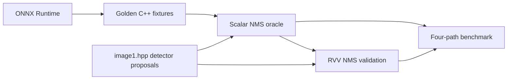
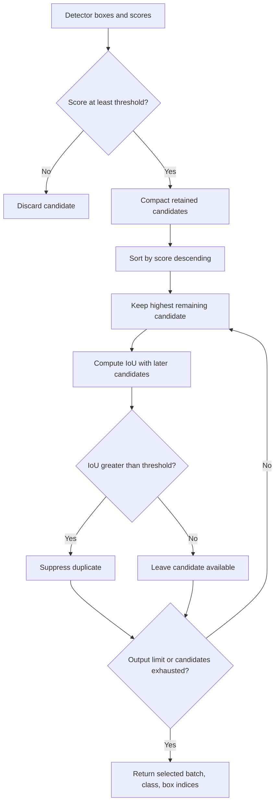
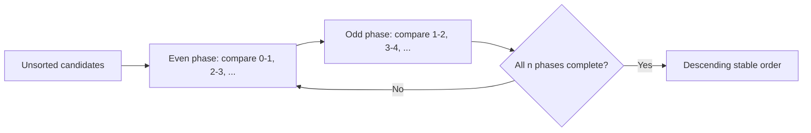
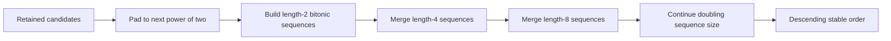
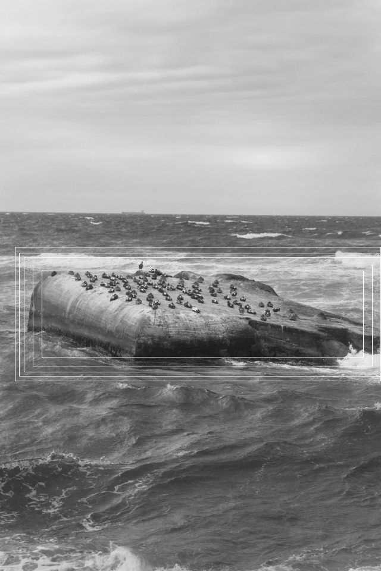
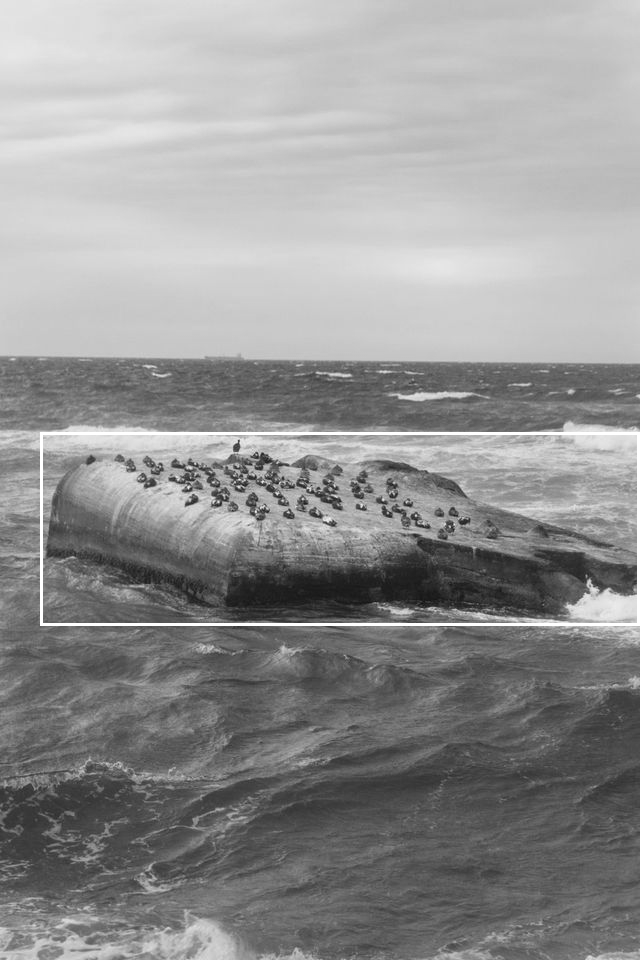

# RISC-V_CV

A RISC-V image-processing library (`vec::` kernels) with a scalar reference
implementation (`ref::`), unit tests, and benchmarks. The whole project
cross-compiles to RISC-V and builds **two images per test/benchmark**:

- **gem5** — bare-metal `.bin` images linked against the
  [nexus-am](https://github.com/OpenXiangShan/nexus-am) abstract-machine
  runtime, run on the **XiangShan gem5 fork** (XS-GEM5) for cycle-accurate
  simulation.
- **qemu-user** — static Linux ELFs (`<name>_qemu`) run under
  `qemu-riscv64` user-mode for fast functional validation.

## Prerequisites

- CMake >= 3.22.
- A GNU RISC-V cross toolchain providing `riscv64-linux-gnu-g++` (GCC 13+
  recommended; the build is validated with GCC 15).
- A checkout of **nexus-am** (provides the `am`/`klib` bare-metal runtime).
- A built **XS-GEM5** (`build/RISCV/gem5.opt`) and its `configs/example/kmhv3.py`.
- **QEMU user-mode** — `qemu-riscv64` from Debian/Ubuntu `qemu-user` (see
  [`SETUP.md`](SETUP.md) for the apt line).

If you don't have nexus-am, XS-GEM5, or QEMU yet, [`SETUP.md`](SETUP.md) walks
through the whole thing from an empty machine: host packages, cloning nexus-am
and XS-GEM5, building DRAMsim3 and gem5, then this project.

## Build

```bash
cmake -S . -B build \
  -DCMAKE_TOOLCHAIN_FILE=cmake/riscv64_xs_toolchain.cmake \
  -DNEXUS_AM_HOME=$HOME/nexus-am -DGEM5_HOME=$HOME/GEM5
cmake --build build -j8
```

This cross-compiles the library, the unit tests, and the benchmarks. Each
test/benchmark produces a gem5 bare-metal `.bin` (via objcopy) and a static
Linux ELF `<name>_qemu`. The nexus-am `am`/`klib` archives are built
automatically as part of the build, so they always match the configured
architecture and `-march`.

If `AM_HOME` / `XIANG_GEM5` are already set in your environment (as the
reference setup does), you can omit the `-D` flags entirely:

```bash
cmake -S . -B build -DCMAKE_TOOLCHAIN_FILE=cmake/riscv64_xs_toolchain.cmake
cmake --build build -j8
```

## Run

**gem5** (cycle-accurate):

```bash
cmake --build build --target run_<app_name>_gem5
```

**qemu-user** (fast functional):

```bash
cmake --build build --target run_<app_name>_qemu
```

gem5 pass/fail is detected from the test summary regex (gem5 does not
propagate the guest's exit code). qemu-user tests use the guest exit code
directly (no PASS/FAIL regex).

Single unit-test
```bash
cmake --build build --target run_Add_test_qemu   # fast functional
cmake --build build --target run_Add_test_gem5   # cycle-accurate
```

All unit-tests
```bash
cmake --build build --target run_unit_tests_qemu   # fast functional
cmake --build build --target run_unit_tests_gem5   # cycle-accurate
```

Benchmark
```bash
cmake --build build --target run_Add_benchmark_gem5   # cycle-accurate
cmake --build build --target run_Add_benchmark_qemu   # fast functional
```

Benchmarks report cycle and retired-instruction counts on gem5 (milliseconds are
meaningless on a cycle-level simulator). Each gem5 run writes a raw UART log to
`build/<dir>/<target>.log` and gem5 stats to `build/<dir>/<target>-m5out/`.
Each qemu run tees to `build/<dir>/<target>.log` (e.g. `unit_tests_qemu.log`).

## Configuration variables

All install locations and flags are CMake cache variables, so anyone can point
the build at their own toolchain / nexus-am / gem5 / QEMU without editing the
build files. Pass them with `-D<VAR>=value` at configure time.

| Variable | Default | Meaning |
| --- | --- | --- |
| `NEXUS_AM_HOME` | `$AM_HOME`, else `~/nexus-am` | nexus-am checkout |
| `GEM5_HOME` | `$XIANG_GEM5`, else `~/GEM5` | XS-GEM5 checkout |
| `GEM5_BINARY` | `${GEM5_HOME}/build/RISCV/gem5.opt` | gem5 binary |
| `GEM5_CONFIG` | `${GEM5_HOME}/configs/example/kmhv3.py` | gem5 config script |
| `GEM5_EXTRA_ARGS` | `--disable-difftest` | Extra gem5 config arguments |
| `QEMU_BINARY` | `qemu-riscv64` on PATH | qemu-riscv64 user-mode emulator |
| `QEMU_CPU` | `max,vlen=128` | QEMU `-cpu` with RVV and a fixed 128-bit VLEN |
| `QEMU_EXTRA_ARGS` | (empty) | Extra qemu-riscv64 arguments |
| `RISCV_TOOLCHAIN_PREFIX` | `riscv64-linux-gnu-` | GNU toolchain triple prefix |
| `AM_ARCH` | `riscv64-xs` | nexus-am target architecture |
| `RISCV_MABI` | `lp64d` | RISC-V `-mabi` |
| `RISCV_MARCH` | `rv64gcv_zba_zbb_zbc_zbs_zbkb_zbkc_zbkx_zknd_zkne_zknh_zkr_zksed_zksh_zkt` | RISC-V `-march` |


## How it works

- **Cross-compile** — `cmake/riscv64_xs_toolchain.cmake` selects the GNU RISC-V
  compilers and shared flags (`-static -mcmodel=medany -fno-rtti
  -fno-exceptions ...`). Freestanding-only flags (`-ffreestanding`, `-fno-builtin`,
  etc.) are applied per-target via `RISCV_BAREMETAL_COMPILE_FLAGS` on bare-metal
  images and libraries only.
- **Two image kinds** — bare-metal images link nexus-am's `am`/`klib` and
  objcopy to `.bin` for gem5. qemu-user images are static Linux ELFs built
  without nexus-am; `riscv_port.hpp` routes I/O to glibc when `RISCV_BAREMETAL`
  is not defined.
- **Bare-metal runtime** — under `RISCV_BAREMETAL`, the library
  (`lib/include/riscv_port.hpp`, `lib/source/riscv_runtime.cpp`) provides
  `operator new`/`delete` over klib's `malloc`/`free`, a `__cxa_pure_virtual`
  trap, cycle counters (`csrr cycle`/`instret` in `lib/include/riscv_timer.hpp`),
  and a static-constructor runner. nexus-am's runtime predates C++: it never
  runs `.init_array` and only enables the FPU, so the runtime enables the vector
  unit (`MSTATUS_VS`) and runs static constructors explicitly. A self-contained
  linker script (`cmake/riscv_init_array.ld`, a copy of nexus-am's
  `loader64.ld`/`section.ld` plus a `KEEP()`ed `.init_array`) keeps those
  constructors from being garbage-collected.
- **Link** — `riscv_add_baremetal_image(<source.cpp>)` creates the executable
  and objcopies the ELF to a raw `.bin`. Callers link `${PROJECT_NAME}` and
  `reference`, then the `riscv_baremetal_runtime` INTERFACE library, which
  supplies `am-${AM_ARCH}.a` and `klib-${AM_ARCH}.a` inside `--start-group`
  (the two archives reference each other) plus bare-metal link options.
- **Unit tests** — real GoogleTest cannot link against klib's bare-metal
  runtime, so `test/framework/include/gtest_lite.hpp` provides a minimal
  self-registering subset (`TEST`, `TEST_P`, `ASSERT_EQ`, `Values`, `Combine`,
  `INSTANTIATE_TEST_SUITE_P`, `RUN_ALL_TESTS`) with gtest-style output that
  ctest can match on.
- **Run on gem5** — `riscv_add_gem5_run(<target>)` takes the bare-metal
  executable target (e.g. `unit_tests_gem5`) and creates a `run_<target>` custom
  target plus a ctest entry (unless `RISCV_GEM5_NO_CTEST` is set on the target).
  The `.bin` path comes from the `RISCV_GEM5_BIN` property set by
  `riscv_add_baremetal_image`. Pass/fail regexes come from target properties
  `RISCV_GEM5_PASS_REGEX` / `RISCV_GEM5_FAIL_REGEX`.
- **Run on qemu-user** — `riscv_add_qemu_run(<target>)` takes the Linux ELF
  target (e.g. `unit_tests_qemu`) and creates `run_<target>` plus a ctest entry
  that runs the ELF under `qemu-riscv64`; ctest uses the guest exit code.

## Image I/O

- **qemu-user** — `Image::Read("in.pgm")` and `Image::Write("out.pgm")` use hosted
  libc to read/write PGM (P2/P5) and PPM (P3/P6). Writes are always binary P5/P6.
- **gem5** — no file I/O on the bare-metal runtime. Images are compiled in as
  headers (`scripts/image_to_header.py`) and loaded with
  `Image::Read(width, height, data)`. `Write` is not supported on gem5.

See [IMAGEIO.md](IMAGEIO.md) for formats and examples.

## Non-Maximum Suppression

This branch adds ONNX-style, corners-only Non-Maximum Suppression with an
NMS-specific implementation flow:

- scalar score filtering, stable sorting, and greedy IoU suppression as the
  correctness oracle;
- RVV score comparison and stable compaction;
- selectable RVV odd-even and padded bitonic sorting;
- RVV indexed box loads and batched IoU suppression;
- caller-owned `order`, `scores`, and `suppressed` workspace arrays, so neither
  kernel allocates memory;
- ONNX Runtime golden fixtures, multi-batch/class tests, vector-tail tests, and
  stable equal-score tests;
- an `image1.hpp` benchmark comparing scalar and RVV versions of both
  odd-even and bitonic NMS.

### Repository structure

The branch separates the production RVV kernel, scalar correctness oracle,
independent golden reference, tests, example, and performance benchmark:

| Path | Purpose |
| --- | --- |
| `lib/include/NMS.hpp` | Public `vec::NonMaxSuppression` API |
| `lib/source/NMS.cpp` | Production RVV score filtering, sorting, and IoU suppression |
| `lib/include/riscv_wrappers.hpp` | Readable wrappers around the RVV intrinsics used by the kernel |
| `test/reference/include/NMS.hpp` | Matching scalar API |
| `test/reference/source/NMS.cpp` | Scalar implementation and correctness oracle |
| `test/GoldenReference/` | ONNX Runtime cases imported from the upstream NMS repository |
| `test/unit_test/source/NMS_test.cpp` | Golden, scalar/RVV, boundary, tail, and stable-order tests |
| `example/source/NMS_image_example.cpp` | `image1.hpp` rock example and annotated PGM output |
| `benchmark/source/NMS_benchmark.cpp` | Four-way scalar/RVV and odd-even/bitonic comparison |



### What NMS does

NMS does not detect objects directly from image pixels. An object detector
first produces multiple candidate boxes and confidence scores. NMS removes
low-confidence candidates, sorts the rest, and suppresses lower-scoring boxes
that describe the same object.



Inputs and output follow the ONNX-style layout:

```text
boxes             [num_batches, spatial_dim, 4]  as [y1, x1, y2, x2]
scores            [num_batches, num_classes, spatial_dim]
selected_indices  [selected_count, 3]            as [batch, class, box]
```

The score comparison is inclusive (`score >= score_threshold`). IoU
suppression is strict (`IoU > iou_threshold`), so a box exactly on the IoU
threshold remains available. Equal scores are ordered by original box index.

### Scalar versus RVV and the two sorting algorithms

There are two implementation styles and two sorting algorithms. They form four
benchmark paths; “RVV odd-even” is one combination, not a third sort:

| Implementation | Odd-even sort | Bitonic sort |
| --- | --- | --- |
| Scalar C++ | Scalar odd-even | Scalar bitonic |
| RISC-V Vector | RVV odd-even | RVV bitonic |

#### Odd-even transposition sort

Odd-even sorting alternates independent adjacent compare-swap phases. Within a
phase, every pair can be processed in parallel. Sorting descending scores
`[0.76, 0.98, 0.79, 0.93]` looks like this:

```text
Input:       [0.76, 0.98, 0.79, 0.93]
Even phase:  (0,1)          (2,3)
             [0.98, 0.76, 0.93, 0.79]
Odd phase:          (1,2)
             [0.98, 0.93, 0.76, 0.79]
Even phase:  (0,1)          (2,3)
             [0.98, 0.93, 0.79, 0.76]
```



The scalar path compares each pair normally. The RVV path uses strided vector
loads and stores so many independent pairs are compared at once. The algorithm
is simple and has no padding, but requires `n` phases and `O(n^2)` comparisons.

#### Bitonic sorting network

Bitonic sorting builds ascending and descending subsequences and repeatedly
merges them into larger sorted sequences. Its compare-swap pattern depends only
on the input size, which makes it suitable for vector execution. Non-power-of-
two candidate counts are padded to the next power of two with `-infinity`
scores, ensuring padding always sorts after real candidates.



The scalar path walks the fixed compare-swap network with nested loops. The RVV
path generates left/right indices for one network stage, gathers many pairs,
performs masked stable compare-swaps, and scatters the results. It uses
`O(n log^2 n)` comparisons and becomes increasingly attractive as the number
of candidates grows.

Both sorting paths use `(score descending, original box index ascending)`, so
equal scores retain their original order. Allocate each workspace array using
`NMSWorkspaceCapacity(spatial_dim, algorithm)`; bitonic sorting may require the
next power of two.

### Image NMS example

`NMS_image_example` uses only `images/image1.hpp`. Five overlapping detector
proposals cover the large central rock and one low-confidence proposal covers
the horizon. NMS does not find the rock from image pixels; it filters the
detector's boxes and retains rock box 0 with score `0.98`. The example confirms
that scalar odd-even, scalar bitonic, RVV odd-even, and RVV bitonic agree.

These are multiple candidate boxes (detector proposals), not multiple kernels.
The NMS kernel receives the boxes and their scores, removes the lower-scoring
overlapping boxes, and produces the final selection shown on the right.

| Before NMS: multiple candidate boxes | After NMS: selected result |
| --- | --- |
|  |  |

```bash
cmake --build build --target run_NMS_image_example_qemu
```

The QEMU run writes the proposals and final selection to:

- `build/example/image1_nms_candidates.pgm`
- `build/example/image1_nms_selected.pgm`

The corresponding gem5 command is:

```bash
cmake --build build --target run_NMS_image_example_gem5
```

### Recorded gem5 results

The current XS-GEM5 run uses `image1` dimensions (640x960), three classes, six
iterations, and 16, 32, 64, or 128 candidates per class. All four paths produced
identical selected indices and the run ended with `Output is correct.` Each cell
below reports **average cycles / cycles per candidate**. The per-candidate value
divides the average cycles by the total candidates in one image
(`3 classes * candidates/class`); the six iterations are already averaged.

| Candidates/class | Total candidates | Scalar odd-even | Scalar bitonic | RVV odd-even | RVV bitonic |
| ---: | ---: | ---: | ---: | ---: | ---: |
| 16 | 48 | 2,827 / 58.89 | 3,804 / 79.25 | 8,398 / 174.95 | 7,816 / 162.83 |
| 32 | 96 | 8,641 / 90.01 | 9,089 / 94.67 | 19,629 / 204.46 | 15,300 / 159.37 |
| 64 | 192 | 32,422 / 168.86 | 29,463 / 153.45 | 73,092 / 380.68 | 49,198 / 256.23 |
| 128 | 384 | 139,433 / 363.10 | 103,157 / 268.63 | 278,224 / 724.54 | 161,977 / 421.81 |

The results show:

- Scalar odd-even wins at 16 and 32 candidates because its lower setup cost
  outweighs bitonic's better asymptotic complexity.
- Scalar bitonic crosses over at 64 candidates and is 1.35x faster than scalar
  odd-even at 128 candidates.
- RVV bitonic is faster than RVV odd-even at every tested size. Its advantage
  grows from 1.07x at 16 candidates to 1.71x at 128 candidates.
- Scalar remains faster than the corresponding RVV path on this gem5 core. At
  128 candidates, RVV bitonic executes far fewer instructions (62,841 versus
  341,932) but takes 161,977 versus 103,157 cycles. This indicates that vector
  setup plus indexed gather/scatter latency dominates this candidate range;
  NMS also retains a sequential greedy-selection dependency.
- The best overall measured path is scalar odd-even for the small cases and
  scalar bitonic for 64 and 128 candidates. The best RVV path is bitonic.

Ratio interpretation is important:

```text
RVV versus scalar       = scalar cycles / RVV cycles
bitonic versus odd-even = odd-even cycles / bitonic cycles

ratio > 1.0x  means the named alternative is faster
ratio < 1.0x  means it is slower
```

Thus `RVV odd-even speedup 0.50x` means RVV odd-even is two times slower than
scalar odd-even; it is a performance ratio below one, not an acceleration.
The full recorded output is in
`build/benchmark/NMS_benchmark_gem5.log` after running the benchmark locally.

Run the functional checks with:

```bash
cmake --build build --target run_NMS_test_qemu
cmake --build build --target run_unit_tests_qemu
cmake --build build --target run_NMS_benchmark_qemu
```

Run the cycle-accurate comparison manually with:

```bash
cmake --build build --target run_NMS_benchmark_gem5
```

The benchmark prints cycles, retired instructions, cycles/candidate, and the
requested cycles/pixel normalization for all four paths. Because NMS processes
detection candidates rather than pixels, cycles/candidate is its native work
metric; cycles/pixel uses the 640x960 `image1` size as a common normalization.

The imported golden reference is documented in
[`test/GoldenReference/UPSTREAM.md`](test/GoldenReference/UPSTREAM.md). To
validate its fixtures directly against ONNX Runtime:

```bash
python3 -m venv .venv-nms
.venv-nms/bin/pip install -r test/GoldenReference/requirements.txt
.venv-nms/bin/python -m pytest test/GoldenReference/test_nms_golden.py -q
```
