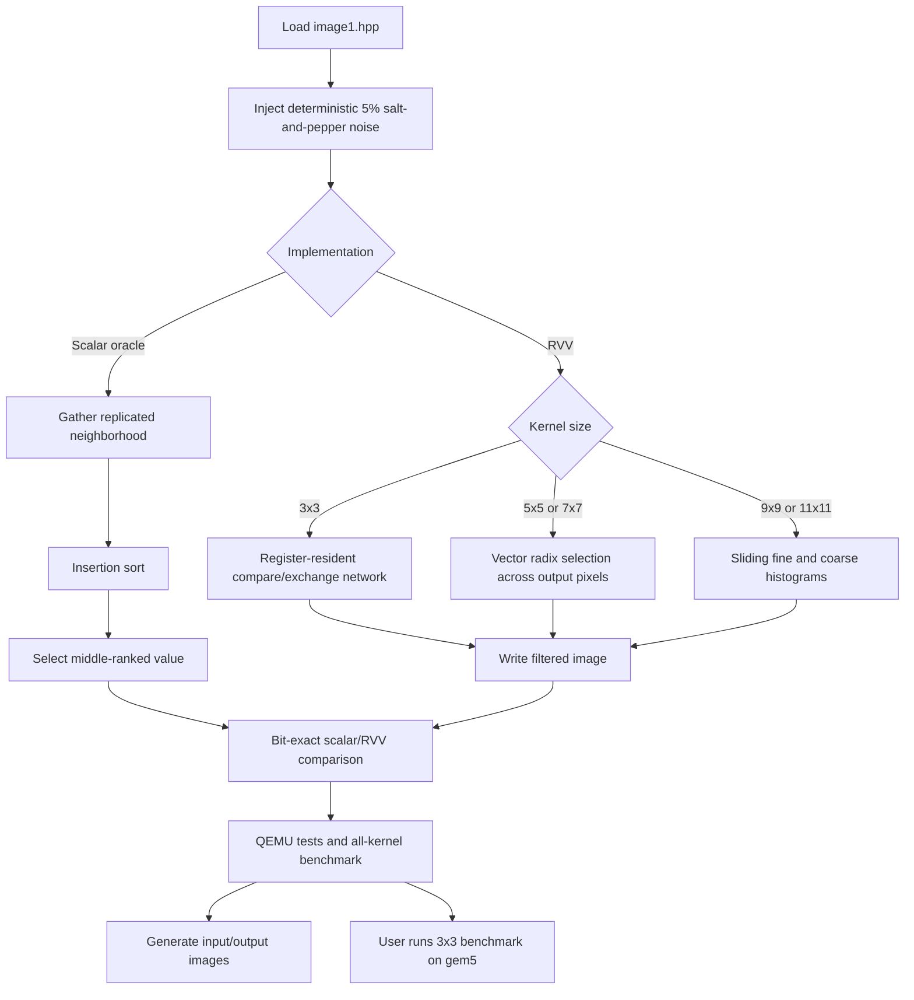

# RISC-V_CV

A RISC-V image-processing library (`vec::` kernels) with a scalar reference
implementation (`ref::`), unit tests, and benchmarks. The whole project
cross-compiles to RISC-V and builds **two images per test/benchmark**:

- **gem5** — bare-metal `.bin` images linked against the
  [nexus-am](https://github.com/OpenXiangShan/nexus-am) abstract-machine
  runtime, run on the **XiangShan gem5 fork** (XS-GEM5) for cycle-accurate
  simulation.
- **qemu-user** — static Linux ELFs (`<name>_qemu`) run under
  `qemu-riscv64` user-mode for fast functional validation.

## Prerequisites

- CMake >= 3.22.
- A GNU RISC-V cross toolchain providing `riscv64-linux-gnu-g++` (GCC 13+
  recommended; the build is validated with GCC 15).
- A checkout of **nexus-am** (provides the `am`/`klib` bare-metal runtime).
- A built **XS-GEM5** (`build/RISCV/gem5.opt`) and its `configs/example/kmhv3.py`.
- **QEMU user-mode** — `qemu-riscv64` from Debian/Ubuntu `qemu-user` (see
  [`SETUP.md`](SETUP.md) for the apt line).

If you don't have nexus-am, XS-GEM5, or QEMU yet, [`SETUP.md`](SETUP.md) walks
through the whole thing from an empty machine: host packages, cloning nexus-am
and XS-GEM5, building DRAMsim3 and gem5, then this project.

## Build

```bash
cmake -S . -B build \
  -DCMAKE_TOOLCHAIN_FILE=cmake/riscv64_xs_toolchain.cmake \
  -DNEXUS_AM_HOME=$HOME/nexus-am -DGEM5_HOME=$HOME/GEM5
cmake --build build -j8
```

This cross-compiles the library, the unit tests, and the benchmarks. Each
test/benchmark produces a gem5 bare-metal `.bin` (via objcopy) and a static
Linux ELF `<name>_qemu`. The nexus-am `am`/`klib` archives are built
automatically as part of the build, so they always match the configured
architecture and `-march`.

If `AM_HOME` / `XIANG_GEM5` are already set in your environment (as the
reference setup does), you can omit the `-D` flags entirely:

```bash
cmake -S . -B build -DCMAKE_TOOLCHAIN_FILE=cmake/riscv64_xs_toolchain.cmake
cmake --build build -j8
```

## Run 

**gem5** (cycle-accurate):

```bash
cmake --build build --target run_<app_name>_gem5
```

**qemu-user** (fast functional):

```bash
cmake --build build --target run_<app_name>_qemu
```

gem5 pass/fail is detected from the test summary regex (gem5 does not
propagate the guest's exit code). qemu-user tests use the guest exit code
directly (no PASS/FAIL regex).

Single unit-test
```bash
cmake --build build --target run_Add_test_qemu   # fast functional
cmake --build build --target run_Add_test_gem5   # cycle-accurate
```

All unit-tests
```bash
cmake --build build --target run_unit_tests_qemu   # fast functional
cmake --build build --target run_unit_tests_gem5   # cycle-accurate
```

Benchmarck 
```bash
cmake --build build --target run_Add_benchmark_gem5   # cycle-accurate
cmake --build build --target run_Add_benchmark_qemu   # fast functional
```

Benchmarks report cycle and retired-instruction counts on gem5 (milliseconds are
meaningless on a cycle-level simulator). Each gem5 run writes a raw UART log to
`build/<dir>/<target>.log` and gem5 stats to `build/<dir>/<target>-m5out/`.
Each qemu run tees to `build/<dir>/<target>.log` (e.g. `unit_tests_qemu.log`).

## Configuration variables

All install locations and flags are CMake cache variables, so anyone can point
the build at their own toolchain / nexus-am / gem5 / QEMU without editing the
build files. Pass them with `-D<VAR>=value` at configure time.

| Variable | Default | Meaning |
| --- | --- | --- |
| `NEXUS_AM_HOME` | `$AM_HOME`, else `~/nexus-am` | nexus-am checkout |
| `GEM5_HOME` | `$XIANG_GEM5`, else `~/GEM5` | XS-GEM5 checkout |
| `GEM5_BINARY` | `${GEM5_HOME}/build/RISCV/gem5.opt` | gem5 binary |
| `GEM5_CONFIG` | `${GEM5_HOME}/configs/example/kmhv3.py` | gem5 config script |
| `GEM5_EXTRA_ARGS` | `--disable-difftest` | Extra gem5 config arguments |
| `QEMU_BINARY` | `qemu-riscv64` on PATH | qemu-riscv64 user-mode emulator |
| `QEMU_CPU` | `max` | QEMU `-cpu` (default `max` for RVV + bitmanip/crypto) |
| `QEMU_EXTRA_ARGS` | (empty) | Extra qemu-riscv64 arguments |
| `RISCV_TOOLCHAIN_PREFIX` | `riscv64-linux-gnu-` | GNU toolchain triple prefix |
| `AM_ARCH` | `riscv64-xs` | nexus-am target architecture |
| `RISCV_MABI` | `lp64d` | RISC-V `-mabi` |
| `RISCV_MARCH` | `rv64gcv_zba_zbb_zbc_zbs_zbkb_zbkc_zbkx_zknd_zkne_zknh_zkr_zksed_zksh_zkt` | RISC-V `-march` |


## How it works

- **Cross-compile** — `cmake/riscv64_xs_toolchain.cmake` selects the GNU RISC-V
  compilers and shared flags (`-static -mcmodel=medany -fno-rtti
  -fno-exceptions ...`). Freestanding-only flags (`-ffreestanding`, `-fno-builtin`,
  etc.) are applied per-target via `RISCV_BAREMETAL_COMPILE_FLAGS` on bare-metal
  images and libraries only.
- **Two image kinds** — bare-metal images link nexus-am's `am`/`klib` and
  objcopy to `.bin` for gem5. qemu-user images are static Linux ELFs built
  without nexus-am; `riscv_port.hpp` routes I/O to glibc when `RISCV_BAREMETAL`
  is not defined.
- **Bare-metal runtime** — under `RISCV_BAREMETAL`, the library
  (`lib/include/riscv_port.hpp`, `lib/source/riscv_runtime.cpp`) provides
  `operator new`/`delete` over klib's `malloc`/`free`, a `__cxa_pure_virtual`
  trap, cycle counters (`csrr cycle`/`instret` in `lib/include/riscv_timer.hpp`),
  and a static-constructor runner. nexus-am's runtime predates C++: it never
  runs `.init_array` and only enables the FPU, so the runtime enables the vector
  unit (`MSTATUS_VS`) and runs static constructors explicitly. A self-contained
  linker script (`cmake/riscv_init_array.ld`, a copy of nexus-am's
  `loader64.ld`/`section.ld` plus a `KEEP()`ed `.init_array`) keeps those
  constructors from being garbage-collected.
- **Link** — `riscv_add_baremetal_image(<source.cpp>)` creates the executable
  and objcopies the ELF to a raw `.bin`. Callers link `${PROJECT_NAME}` and
  `reference`, then the `riscv_baremetal_runtime` INTERFACE library, which
  supplies `am-${AM_ARCH}.a` and `klib-${AM_ARCH}.a` inside `--start-group`
  (the two archives reference each other) plus bare-metal link options.
- **Unit tests** — real GoogleTest cannot link against klib's bare-metal
  runtime, so `test/framework/include/gtest_lite.hpp` provides a minimal
  self-registering subset (`TEST`, `TEST_P`, `ASSERT_EQ`, `Values`, `Combine`,
  `INSTANTIATE_TEST_SUITE_P`, `RUN_ALL_TESTS`) with gtest-style output that
  ctest can match on.
- **Run on gem5** — `riscv_add_gem5_run(<target>)` takes the bare-metal
  executable target (e.g. `unit_tests_gem5`) and creates a `run_<target>` custom
  target plus a ctest entry (unless `RISCV_GEM5_NO_CTEST` is set on the target).
  The `.bin` path comes from the `RISCV_GEM5_BIN` property set by
  `riscv_add_baremetal_image`. Pass/fail regexes come from target properties
  `RISCV_GEM5_PASS_REGEX` / `RISCV_GEM5_FAIL_REGEX`.
- **Run on qemu-user** — `riscv_add_qemu_run(<target>)` takes the Linux ELF
  target (e.g. `unit_tests_qemu`) and creates `run_<target>` plus a ctest entry
  that runs the ELF under `qemu-riscv64`; ctest uses the guest exit code.

## Median filter

The median filter replaces each pixel with the middle-ranked value in its local
neighborhood. It removes isolated salt-and-pepper noise without averaging those
extreme values into nearby pixels. This implementation supports 8-bit grayscale
images and the odd square kernels `3x3`, `5x5`, `7x7`, `9x9`, and `11x11`.
Output dimensions match the input, and samples outside the image use replicated
edge pixels.

The scalar implementation is the correctness oracle: it gathers every
neighborhood, insertion-sorts it, and selects `kernel_size * kernel_size / 2`.
The RVV implementation dispatches to a strategy suited to each kernel size:

- `3x3` loads nine neighboring vectors and runs a fixed 20-comparison median
  selection network derived by pruning the 9-input network from
  [Bert Dobbelaere's catalog](https://bertdobbelaere.github.io/sorting_networks.html).
- `5x5` and `7x7` use eight exact radix-selection passes. Each vector lane is an
  independent output pixel; every pass counts neighborhood values below a trial
  prefix and decides one median bit.
- `9x9` and `11x11` maintain sliding per-column histograms. RVV adds and removes
  256 fine bins plus 16 coarse bins in parallel, while the two-level lookup
  identifies the exact median with at most 32 scalar bin checks.

All RVV row loops use dynamic `vsetvl`: a chunk uses the hardware's available
lanes, and the final chunk automatically shrinks to the remaining pixels.
`9x9` and `11x11` require caller-owned `uint16_t` histogram storage sized by
`MedianFilterWorkspaceCapacity`; allocation remains outside the kernel and
outside benchmark timing.



### Correctness and benchmark commands

```bash
# Focused tests covering all five kernels, borders, tiny images, and RVV tails
cmake --build build --target run_MedianFilter_test_qemu

# Aggregate repository test suite
cmake --build build --target run_unit_tests_qemu

# Scalar-versus-RVV QEMU comparison for all five kernels
cmake --build build --target run_MedianFilter_benchmark_qemu

# Cycle-accurate 3x3 comparison (run by the user)
cmake --build build --target run_MedianFilter_benchmark_gem5

# Regenerate the PNG-only noisy input and five filtered outputs
cmake --build build --target run_MedianFilter_image_example_qemu
python3 scripts/pgm_to_png.py --output-directory images --remove-source \
    /tmp/median_filter_*.pgm
```

QEMU validates RVV behavior and benchmark completion, but its CSR timing is not
cycle-accurate, and these figures can vary between runs. They must not be used
to claim performance on hardware. Use the gem5 command for the authoritative
`3x3` cycle and retired-instruction comparison.

### Noisy input and filtered outputs

The example copies the 640x960 grayscale pixels compiled into `image1.hpp`, then
changes approximately 5% of them to black or white using a fixed-seed generator.
The original `image1.hpp` data remains unchanged. Intermediate PGM files are
created under `/tmp`, converted, and removed; the repository retains PNG images
only.

| Noisy input | `3x3` output |
| --- | --- |
|  |  |

| `5x5` output | `7x7` output |
| --- | --- |
|  |  |

| `9x9` output | `11x11` output |
| --- | --- |
|  |  |

### gem5 benchmark result

The cycle-accurate `3x3` benchmark processed 12,288 pixels. The scalar and RVV
outputs matched exactly.

| Implementation | Cycles | Retired instructions | Pixels/cycle |
| --- | ---: | ---: | ---: |
| Scalar | 1,006,355 | 4,859,844 | 0.012210 |
| RVV | 50,069 | 96,170 | 0.245421 |

| Result | Value |
| --- | ---: |
| Scalar/RVV speedup | **20.099x** |
| Correctness | Exact match |

## Image I/O

- **qemu-user** — `Image::Read("in.pgm")` and `Image::Write("out.pgm")` use hosted
  libc to read/write PGM (P2/P5) and PPM (P3/P6). Writes are always binary P5/P6.
- **gem5** — no file I/O on the bare-metal runtime. Images are compiled in as
  headers (`scripts/image_to_header.py`) and loaded with
  `Image::Read(width, height, data)`. `Write` is not supported on gem5.

See [IMAGEIO.md](IMAGEIO.md) for formats and examples.
