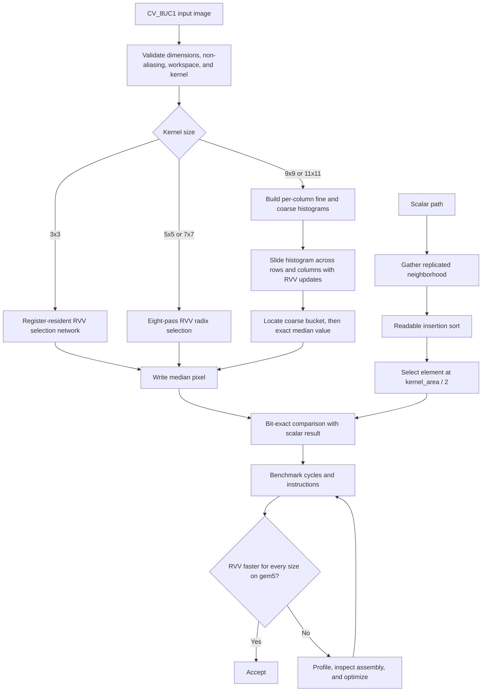

# Optimized RISC-V Vector Median Filter Plan

## Summary and algorithm

Implement a same-size median filter for 8-bit grayscale images with replicated
borders. Both implementations support exactly `3x3`, `5x5`, `7x7`, `9x9`, and
`11x11` kernels.

For each output pixel, the filter gathers the odd-sized neighborhood and returns
the middle-ranked value. Unlike an average, the median is resistant to isolated
bright or dark noise.

The design follows Andrew Adams' *Fast Median Filters using Separable Sorting
Networks*:

- Fixed sorting networks avoid data-dependent branches and map naturally to RVV
  `vminu`/`vmaxu` operations.
- Presorting vertical columns shares work between neighboring windows.
- Selection networks discard comparisons that cannot affect the median.
- For `9x9` and `11x11` 8-bit inputs, a sliding histogram is preferable because
  sorting-network cost grows rapidly while the intensity range remains fixed at
  256 values.

Implementation references:

- Andrew Adams, *Fast Median Filters using Separable Sorting Networks*, supplied
  locally at `/home/mohamed/riscv/median/3450626.3459773_2.pdf`.
- Bert Dobbelaere's [List of sorting networks](https://bertdobbelaere.github.io/sorting_networks.html),
  which catalogs comparator sequences and size/depth tradeoffs for small input
  counts. Use its 9-input network as the source for the pruned `3x3` median
  selection path and cross-check the expected comparator ordering before
  implementation.

## Public API and implementation

- Add matching `ref::MedianFilter` and `vec::MedianFilter` APIs accepting input,
  output, kernel size, and caller-owned workspace. Reject unsupported kernels,
  mismatched dimensions, insufficient workspace, and in-place operation with
  assertions.
- At the start of the implementation phase, search the then-current branch's
  `.hpp` files for an existing workspace, capacity, buffer-sizing, alignment, or
  next-power-of-two helper. Reuse or extend a suitable existing helper instead
  of creating duplicate functionality. Only if no suitable helper exists,
  introduce a median-filter-specific deterministic workspace-requirements
  helper. Kernels perform no dynamic allocation:
  - The scalar path uses a fixed 121-byte stack array, the largest supported
    neighborhood, and the small-kernel RVV paths keep their state in registers.
  - Caller-owned `uint16_t` workspace holds the `9x9` and `11x11` histogram
    counts; 121 is the largest possible neighborhood count.
- Implement the scalar reference as follows:
  - Clamp neighborhood coordinates to implement replicated borders.
  - Gather all samples, perform an intentionally straightforward insertion sort,
    and select `kernel_area / 2`.
  - Keep it readable and independent of RVV optimization details.
- Implement the RVV small-kernel paths as follows:
  - Use dynamic `vsetvl`; never assume a fixed VLEN.
  - Use a register-resident pruned network for `3x3`.
  - For `5x5` and `7x7`, use eight exact radix-selection passes across
    independent output-pixel lanes. Each pass counts neighborhood samples below
    a trial prefix and fixes one result bit, avoiding register spills from
    keeping 25 or 49 samples live at once.
  - Derive and document the `3x3` comparator table from the referenced sorting
    network catalog, pruning comparisons that cannot influence the median wire.
  - Handle thin images and border bands with the same replicated semantics
    without burdening the interior hot path.
- Implement the RVV large-kernel paths as follows:
  - Maintain 256 fine bins and 16 coarse bins per column.
  - Vectorize indexed column updates and contiguous histogram add/subtract
    operations while sliding the window.
  - Find the median by scanning the 16 coarse bins and then the corresponding 16
    fine bins.
- Introduce descriptive constants such as `kIntensityLevelCount`,
  `kCoarseBinCount`, `kFineBinsPerCoarseBin`, and `kSupportedKernelSizes`.
  Avoid unexplained numeric literals.
- Export the production and reference headers through the existing aggregate
  headers. Existing CMake globs should discover the new sources without
  build-system changes.
- Copy the complete `skill-package/riscv-cv-algorithm` package unchanged from
  `NMS_Task`, validate it with the skill-creator `quick_validate.py`, and follow
  its scalar/RVV/test/benchmark workflow.
- Preserve the existing untracked `.venv-nms` directory and all unrelated work.

## Testing and benchmarking

- Unit-test every supported kernel against the scalar oracle using:
  - Hand-calculated neighborhoods, impulses, gradients, checkerboards,
    duplicate-heavy values, all-zero/all-255 images, and deterministic random
    images.
  - Corners and edges proving replicated-border behavior.
  - Images smaller than a kernel and images with no vectorizable interior.
  - Widths below, equal to, and beyond vector chunks, including RVV tails and
    multiple rows.
  - Histogram thresholds around intensity boundaries such as 15/16 and exact
    median-count crossings.
- Validate the pruned `3x3` selection network independently with every binary
  3x3 input patch before relying on it in image-level RVV tests.
- Benchmark all five kernels on identical deterministic image data:
  - Load `image1.hpp` and inject deterministic 5% salt-and-pepper noise without
    modifying the original image asset.
  - Allocate and initialize images and workspaces outside timed regions.
  - Warm both paths, alternate measurement order, average repeated runs, and
    verify outputs after every run.
  - Report cycles, retired instructions, cycles/pixel, pixels/cycle, and
    `scalar_cycles / vector_cycles`.
- Use QEMU for functional tests and benchmark completion only. Run all five
  kernel sizes under QEMU. Build the gem5 benchmark but leave its execution to
  the user, who will measure the `3x3` case in the terminal.
- Treat a gem5 speedup greater than `1.00x` for `3x3` as the cycle-accurate
  performance acceptance gate. If it misses the gate, use the user's result to
  inspect generated RVV assembly and gem5 statistics, then tune the network,
  LMUL, or memory access before rerunning.
- Perform final verification in this order:
  1. Build all targets.
  2. Run `run_MedianFilter_test_qemu`.
  3. Run `run_unit_tests_qemu`.
  4. Run `run_MedianFilter_benchmark_qemu`.
  5. Run the QEMU image example to generate the noisy input and filtered output
     for each kernel, convert them to README-compatible images, and document the
     flowchart and results in `README.md` only after the tests pass.
  6. Inspect RVV assembly for the intended vector min/max operations, indexed
     histogram operations, and safe tail handling.
  7. Provide `run_MedianFilter_benchmark_gem5` for the user to run with the
     `3x3` benchmark case.

## Assumptions and boundaries

- Pixel type is exclusively unsigned 8-bit grayscale.
- Output dimensions equal input dimensions, and borders use edge replication.
- Supported kernel sizes are exactly `3`, `5`, `7`, `9`, and `11`; rectangular
  or even kernels are out of scope.
- Include a QEMU image example and README input/output images. RGB support,
  floating-point support, and in-place filtering remain out of scope.
- Use the searchable text extracted from the supplied paper under `/tmp` during
  implementation. Do not copy the copyrighted paper text into the repository.
- Implementation begins only after the user's explicit approval of this plan.
